# StudyWeb

以 Next.js 前端與 Express／MongoDB 後端組成的課程與教學內容平台。提供課程、影片、問答、公告和使用者管理，並整合 LINE 登入與 Vimeo 影片服務。

這個倉庫同時保存前後端，但它們是兩個獨立 npm 專案。網站首頁可以在本機開啟；完整課程、上傳和登入功能需要 MongoDB、LINE 與 Vimeo 設定。單純完成前端建置不代表外部服務已驗收。

## 目錄

- [功能與架構](#功能與架構)
- [環境需求](#環境需求)
- [快速開始](#快速開始)
- [環境設定](#環境設定)
- [目錄與路由](#目錄與路由)
- [建置與驗證](#建置與驗證)
- [資料備份與部署](#資料備份與部署)
- [常見問題](#常見問題)

## 功能與架構

| 功能 | 對應內容 |
|---|---|
| 課程與影片 | 課程資料、成員權限、影片上傳與播放 |
| 問答與教學內容 | 課程問題、回覆及公開內容整理 |
| 公告與首頁 | 公告、輪播與可編輯的內容 |
| 使用者與管理 | 個人資訊、角色與課程管理 |
| 身分驗證 | LINE OAuth、Session 與 JWT |
| 資源處理 | 圖片壓縮、上傳、下載與本機資源檔案 |
| 維護 | 清理任務、資料與資源備份工具 |



圖源：[architecture.mmd](docs/architecture.mmd)。Vimeo 的影片服務與 MongoDB 的課程資料是不同的保存位置，備份與還原時需要分開處理。

## 環境需求

- Node.js 與 npm；目前前端使用 Next.js `15.1.6`、React `18.3` 系列。兩個套件未在根 package 宣告統一 Node 版本，請採能安裝其鎖定套件的版本。
- 可存取的 MongoDB。
- LINE Login Channel，以及回呼網址設定。
- Vimeo API 憑證與具備相應功能的帳號。
- 執行資料庫備份時需要 MongoDB Database Tools，包括 `mongodump`／`mongorestore`。

## 快速開始

從倉庫根目錄安裝兩個部分：

```powershell
npm ci --prefix server
npm ci --prefix client
```

先複製公開範例為自己的本機設定：

```powershell
Copy-Item server/example.env server/.env
Copy-Item client/example.env client/.env.local
```

設定參考下一節。前端的公開網址設定在建置前就必須存在。

後端終端：

```powershell
cd server
node index.js
```

前端終端：

```powershell
cd client
npm run dev -- --hostname 127.0.0.1 --port 3000
```

開啟 `http://localhost:3000/`。後端預設是 `8080`，需從其日誌確認 MongoDB 連線，而不是只看 HTTP port 已監聽。LINE 和 Vimeo 尚未設定時，相應功能不會因為頁面可開啟而自動成立。

## 環境設定

後端 `.env` 的本機示例：

```dotenv
PORT=8080
DB_IP=mongodb://127.0.0.1:27017/studyweb_dev
CLIENT_IP=http://localhost:3000
SERVER_IP=http://localhost:8080
MYSESSIONSECRET=replace_with_random_session_secret
PASSPORT_SECRET=replace_with_random_jwt_secret
LINECHANNELID=replace_with_line_channel_id
LINECHANNELSECRET=replace_with_line_channel_secret
VIMEO_CLIENT_ID=replace_with_vimeo_client_id
VIMEO_CLIENT_SECRET=replace_with_vimeo_client_secret
VIMEO_ACCESS_TOKEN=replace_with_vimeo_token
NODE_ENV=development
```

前端 `client/.env.local`：

```dotenv
NEXT_PUBLIC_CLIENT_IP=http://localhost:3000
NEXT_PUBLIC_SERVER_IP=http://localhost:8080
```

| 設定類別 | 注意事項 |
|---|---|
| MongoDB | `DB_IP` 是連線 URI；應使用獨立開發資料庫 |
| Session／JWT | `MYSESSIONSECRET` 與 `PASSPORT_SECRET` 是兩種用途，勿隨意混用 |
| LINE | 回呼路徑由 `${SERVER_IP}/auth/successful` 組合，需與 Channel 設定一致 |
| Vimeo | 上傳與影片管理依帳號權限及 API 憑證，不能假設公開 token 具有寫入能力 |
| 公開前端設定 | `NEXT_PUBLIC_*` 會進入瀏覽器，不得放入私密金鑰 |
| 反向代理 | 公開 API 可能有 `/api` 前綴；直接本機啟動的 Express 路由沒有這個總前綴 |

後端 CORS、cookie、CSP 與信任代理的設定需對應實際網站入口。[server/config/accessConfig.json](server/config/accessConfig.json) 另有存取限制，遇到登入後 token 失效時也要一起檢查。

## 目錄與路由

| 路徑 | 責任 |
|---|---|
| [client/pages](client/pages) | Pages Router 頁面、課程、問答、公告和個人功能 |
| [client/components](client/components) | 共用頁首、頁尾與介面元件 |
| [client/method](client/method) | API 呼叫、身分與影片上傳工具 |
| [server/index.js](server/index.js) | Express、MongoDB、Session、中間件與路由掛載 |
| [server/routes](server/routes) | 登入、課程、使用者、內容及系統管理 |
| [server/models](server/models) | Mongoose 資料模型 |
| [server/resource](server/resource) | 資源路由與本機檔案保存 |
| [server/methods](server/methods) | Vimeo 和圖片處理 |
| [server/jobs](server/jobs) | 定期清理任務 |
| [server/utils/backup.js](server/utils/backup.js) | 資源與 MongoDB 備份、還原 |

後端掛載 `/auth`、`/resource`、`/publicResource`、`/modifyResource`、`/user`、`/course` 和 `/system`。登入、JWT 與管理權限以路由和 [Passport 設定](server/config/passport.js) 為準。

## 建置與驗證

```powershell
npm --prefix client run build
npm --prefix client run start -- --hostname 127.0.0.1 --port 3000
node --check server/index.js
```

正式啟動 `next start` 前需先成功產生 `.next/`。`client/package.json` 保留 `lint` 指令，但能否作為獨立完整檢查仍需核對該版 Next CLI 與 ESLint 設定。

人工驗證請依 [client/TestManual.md](client/TestManual.md) 執行，涵蓋桌面與手機頁首、公告、個人功能、課程、影片、問答和管理操作。清單是待測項目，不是每項都通過的紀錄。

## 資料備份與部署

備份工具在 `server` 目錄執行，Mongo URI 需另外提供：

```powershell
cd server
npm run backup -- --mongoUri=mongodb://127.0.0.1:27017/studyweb_dev
```

備份包含本機 `resource/` 內容與 MongoDB 匯出。Vimeo 雲端影片不會因此下載成完整影片備份。還原工具支援 `full`、`partial` 與 `add`；`full` 具有覆蓋與刪除行為，必須先在測試目錄驗證，再參考 [工具原始碼](server/utils/backup.js) 操作。

Production 需分別管理 Next 與 Express 程序、MongoDB、持久化資源目錄、HTTPS 及 LINE 回呼。`NODE_ENV=production` 會影響 secure cookie，代理層應正確傳遞來源與協議資訊。

## 常見問題

| 現象 | 檢查 |
|---|---|
| 頁面請求變成 `undefined/...` | 前端 `NEXT_PUBLIC_SERVER_IP` 是否在啟動及建置前設定 |
| 建置時某頁失敗 | 前端環境設定、元件初始化和該頁預渲染依賴 |
| LINE 登入無法完成 | Channel ID／Secret、`SERVER_IP`、回呼路徑、Session cookie |
| 影片上傳失敗 | Vimeo 帳號權限、token、上傳流程與檔案條件 |
| 圖片或資源 404 | 本機資源保存位置、API base、反向代理前綴與存取權限 |
| HTTP 啟動但內容載入失敗 | MongoDB 連線、測試資料及後端路由是否可用 |
| 備份沒有資料庫內容 | 是否提供 Mongo URI、Database Tools 是否存在與可執行 |

其他原有資料可從 [前端起始說明](client/README.md)、[頁面檢查清單](client/TestManual.md) 與 [client/copy.md](client/copy.md) 閱讀。前端起始說明包含 Next.js 範本內容，實際專案操作應以這份根目錄文件和程式為準。

## 專案倉庫

本倉庫：[Du121793/study-web](https://github.com/Du121793/study-web)。

## 本機私有設定

公開倉庫只提供範例設定。實際 `.env`、API token、Wi-Fi 密碼、裝置金鑰和私有設定檔保留在本機，範例占位值必須換成自己的設定才能使用相應服務。
